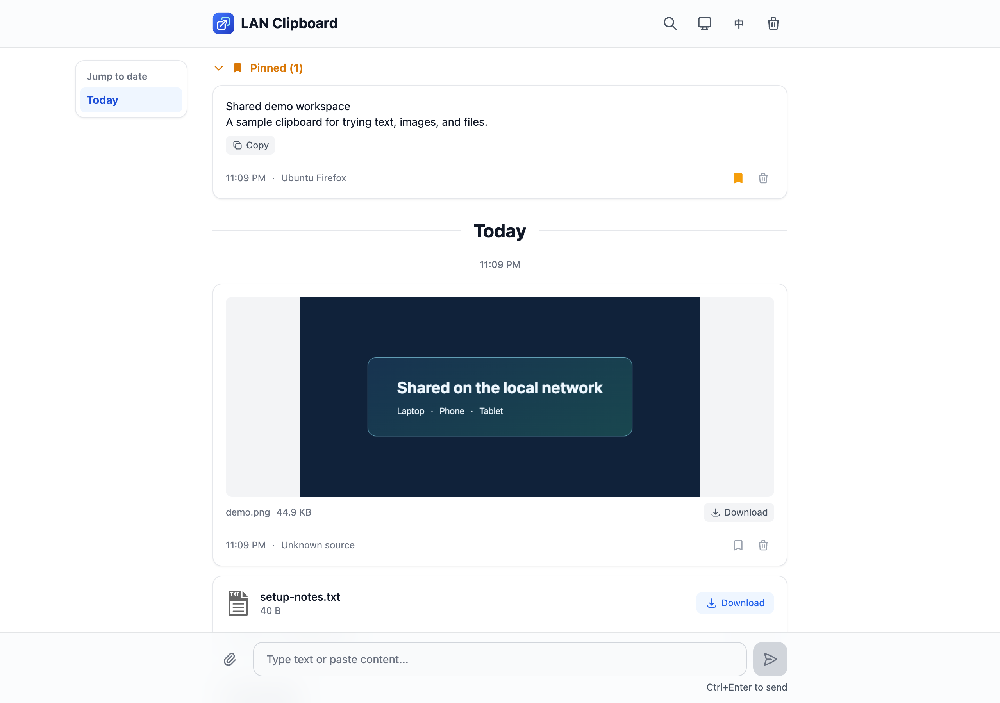
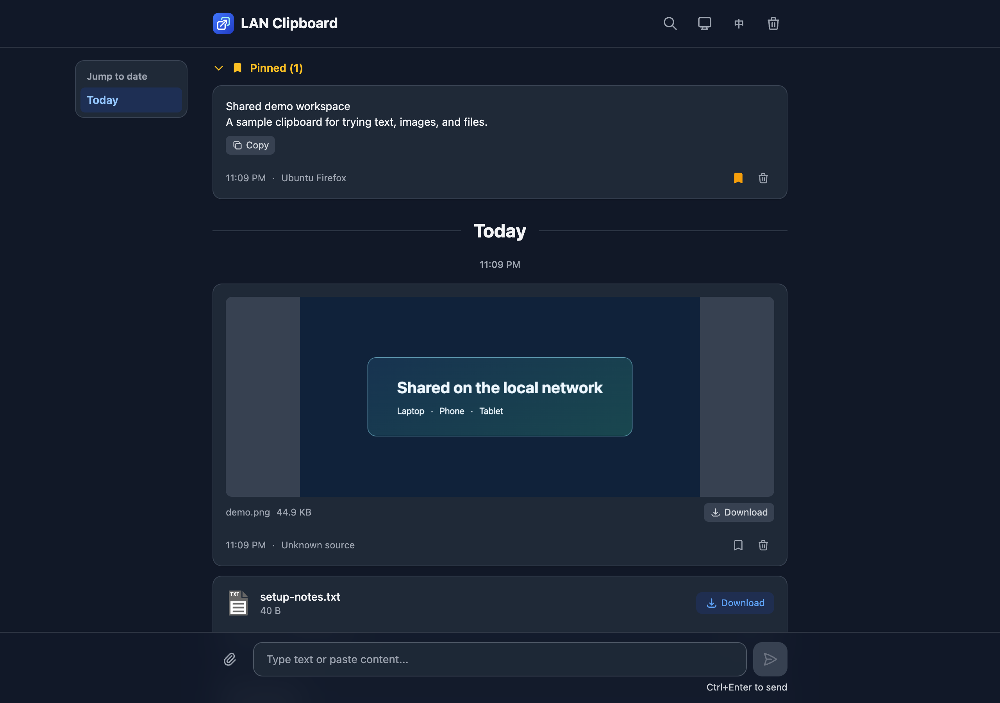
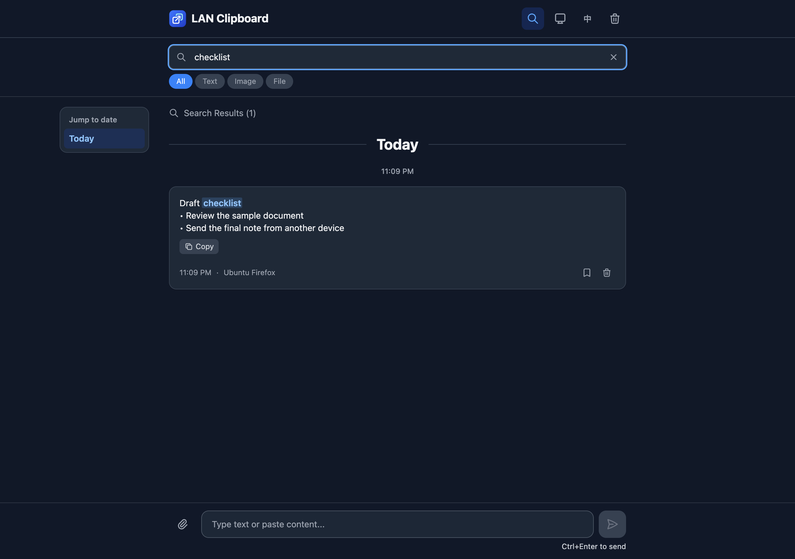
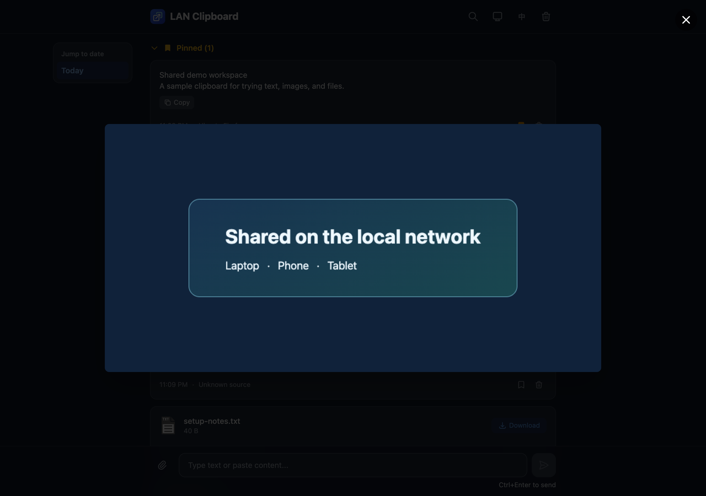
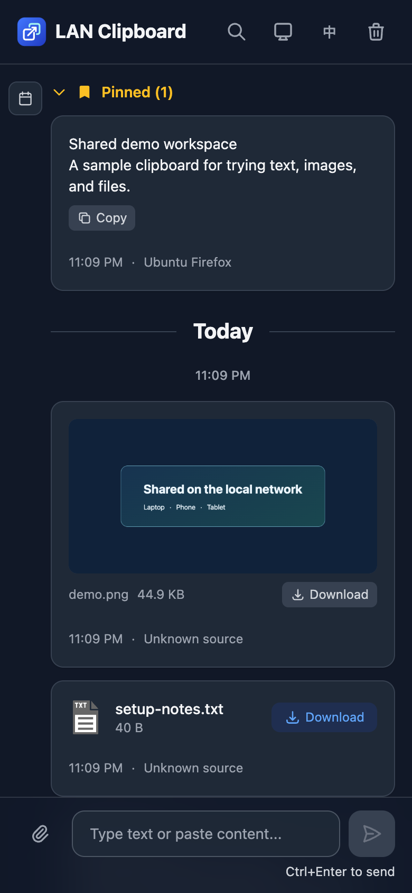

# LAN Clipboard · 局域网剪贴板

同一局域网内跨设备共享剪贴板内容：任意设备打开网页，粘贴文本、上传图片/文件，其他设备通过 WebSocket **实时收到**。支持全文搜索、置顶、深色模式、中英文切换和非置顶内容自动清理。

单进程部署 —— Go 服务同时提供 REST API、WebSocket 和前端静态页面。

## Docker 快速开始

安装 Docker 和 Docker Compose v2。在 GitHub 仓库的 **Releases** 中打开一个稳定版本，下载附件里的 `compose.yaml`。在文件所在的目录运行：

```sh
docker compose up -d
docker compose ps
```

容器变为 `healthy` 后打开 [http://127.0.0.1:18080](http://127.0.0.1:18080)。公开镜像可匿名拉取，SQLite 和上传文件保存在 Docker 命名卷 `lan-clipboard_app-data`。

应用面向受信任的设备，能够访问服务的客户端可以读取、上传和清空剪贴板。默认端口绑定到本机。需要其他设备访问时，按[部署指南](docs/deployment.md)配置局域网地址或受保护的反向代理。

**English quick start.** Download `compose.yaml` from a stable GitHub Release, then run `docker compose up -d` in that directory. Open [http://127.0.0.1:18080](http://127.0.0.1:18080) when `docker compose ps` reports `healthy`. The clipboard is shared with every client that can reach it. Restrict access to trusted devices.

## 界面预览

| 桌面端（浅色） | 桌面端（深色） |
| --- | --- |
|  |  |

| 全文搜索 | 图片预览 | 移动端（深色） |
| --- | --- | --- |
|  |  |  |

## 功能

- **跨设备实时同步**：文本 / 图片 / 文件，WebSocket 广播（断线自动重连 + 重连后补拉数据）
- **多种输入方式**：输入框发送、拖拽文件、粘贴图片、文件选择、Ctrl/⌘+Enter 发送
- **图片缩略图**：超过阈值的大图自动生成 800px JPEG 缩略图，列表加载更快
- **卡片预览**：浏览器支持的音视频、Markdown、Excel（`.xlsx`）、PDF，以及通过局域网转换服务预览 Word（`.docx`）和 PowerPoint（`.pptx`）
- **上传来源**：卡片显示上传时从浏览器 UA 识别的系统和浏览器名称，历史记录显示「来源未知」
- **全文搜索**：FTS5 + LIKE 子串双通道匹配，支持中文词（如「实际」）、英文词/前缀（如「artic」→「article」）、多关键词与类型筛选
- **整理**：置顶/取消置顶、单条删除、一键清空、按日期分组、无限滚动
- **体验**：深色/浅色/跟随系统主题、中英文界面、搜索结果关键词高亮、Toast 提示、图片预览灯箱、复制按钮
- **自动清理**：非置顶内容保留 30 天后，每天凌晨 3 点自动删除（含磁盘文件）
- **安全**：文件名清洗、上传/下载路径穿越防护、服务内文件仅通过 API 暴露

## 技术栈

| 层 | 技术 |
| --- | --- |
| 后端 | Go 1.27.4+ · Gin · gorilla/websocket · mattn/go-sqlite3 (FTS5) · google/uuid (UUIDv7) · disintegration/imaging |
| 前端 | React 18 · TypeScript · Vite 5 · Tailwind CSS · Zustand · i18next |

## 目录结构

```
LAN Clipboard/
├── Makefile              # 构建 / 开发 / 测试入口
├── README.md
├── docs/screenshots/     # 界面截图
├── scripts/smoke.sh      # 端到端冒烟测试
├── server/               # Go 服务（API + WebSocket + 静态托管）
│   ├── config/           # 环境变量配置
│   ├── handler/          # REST handlers（clip / file / search / ws）+ 单元测试
│   ├── middleware/       # CORS
│   ├── model/            # Clip 数据模型
│   ├── store/            # SQLite + FTS5 + 过期清理调度 + 单元测试
│   ├── ws/               # WebSocket hub / client
│   ├── router.go         # 路由装配（含 SPA 静态回退）
│   ├── main.go
│   ├── main_test.go      # API / WebSocket / 静态文件集成测试
│   └── static/           # 前端构建产物（make static 生成，git 忽略）
└── web/                  # React + TS 前端
    └── src/
        ├── api/          # REST + WebSocket 客户端
        ├── components/   # Clipboard / Layout / Common / Search / Upload
        ├── hooks/        # useWebSocket / useTheme / useInfiniteScroll / useClipboard
        ├── i18n/         # 中文 / 英文文案
        ├── store/        # Zustand 状态管理
        ├── types/  utils/
        └── App.tsx  main.tsx
```

## 从源码运行

安装 **Go 1.27.4+**、**Node.js 22.13+ / npm**、Make 和 C 编译器（Linux 用 GCC，macOS 可用 Xcode Command Line Tools）。也可以用 `make bootstrap-go` 将 Go 工具链下载到项目的 `.tools/`。首次运行在仓库根目录安装锁定的前端依赖：

```bash
npm ci --prefix web
make run
# 打开 http://localhost:8080
```

源码启动默认监听 `127.0.0.1:8080`。如需从其他设备访问，可用 `CLIP_LISTEN_HOST` 绑定主机的局域网地址，并限制该端口的访问范围。

### 手工构建（不用 Makefile）

```bash
# 1. 前端
npm ci --prefix web && npm --prefix web run build

# 2. 后端（注意 go-sqlite3 需要 sqlite_fts5 构建标签，否则 FTS5 不可用、服务启动失败）
cd server && go build -tags sqlite_fts5 -o ../bin/lan-clipboard .

# 3. 静态文件与运行
cd .. && rm -rf server/static && cp -R web/dist server/static
cd server && ../bin/lan-clipboard
```

## 开发模式

两个终端分别执行：

```bash
make dev-server   # API + WebSocket，监听 :8080
make dev-web      # Vite 开发服务器（热更新），把 /api 和 /ws 代理到 :8080
```

然后访问 http://localhost:5173 。后端找不到静态目录时只提供 API，不影响开发。

## 配置项（环境变量）

| 变量 | 默认值 | 说明 |
| --- | --- | --- |
| `CLIP_LISTEN_HOST` | `127.0.0.1` | 源码启动的监听地址，容器内设为 `0.0.0.0` |
| `CLIP_PORT` | `8080` | HTTP 监听端口 |
| `CLIP_PUBLIC_ORIGIN` | 空 | 自定义域名或反向代理的浏览器来源，例如 `https://clip.example.test` |
| `CLIP_DATA_DIR` | `./data` | 数据库与上传文件根目录（相对启动目录） |
| `CLIP_STATIC_DIR` | `./static` | 前端构建产物目录 |
| `CLIP_MAX_FILE_SIZE` | `300` | 单文件上限（MB） |
| `CLIP_MAX_TEXT_SIZE` | `307200` | 单条文本上限（bytes，默认 300KB） |
| `CLIP_RETENTION_DAYS` | `30` | 非置顶内容保留天数（每天 03:00 清理） |
| `CLIP_THUMBNAIL_THRESHOLD` | `10` | 图片超过该大小（MB）才生成缩略图 |
| `CLIP_OFFICE_CONVERTER_URL` | 空 | 可选 Gotenberg 地址，例如 Compose 内网的 `http://office:3000` |

数据布局：

```
{DATA_DIR}/clipboard.db                     # SQLite（WAL 模式）
{DATA_DIR}/uploads/YYYY/MM/DD/<uuid>_<名称>  # 原文件
{DATA_DIR}/uploads/YYYY/MM/DD/<uuid>_<名称去扩展名>_thumb.jpg
{DATA_DIR}/previews/<uuid>.pdf               # Word / PowerPoint 预览缓存
```

## API

| 方法 | 路径 | 说明 |
| --- | --- | --- |
| `POST` | `/api/clips` | 新建文本，body：`{"content":"..."}` |
| `GET` | `/api/clips?cursor=&limit=&type=` | 非置顶列表，返回 `{clips, hasMore, nextCursor}` |
| `GET` | `/api/clips/pinned` | 置顶列表，返回 `{clips}` |
| `GET` | `/api/clips/search?q=&type=` | 全文搜索（FTS5 + 子串匹配），返回 `{clips}` |
| `GET` | `/api/clips/:id` | 单条详情 |
| `GET` | `/api/clips/:id/preview` | 生成或读取 Word / PowerPoint 的 PDF 预览 |
| `PATCH` | `/api/clips/:id` | 更新置顶：`{"pinned": true\|false}` |
| `DELETE` | `/api/clips/:id` | 删除单条（同时删除磁盘文件） |
| `DELETE` | `/api/clips` | 清空全部 |
| `POST` | `/api/clips/upload` | 上传文件（multipart 字段 `files` 或 `file`），返回 `{clips: []}` |
| `GET` | `/api/files/*filepath` | 下载原文件；图片默认 inline，音视频和 PDF 可用 `?preview=1` 以内联方式获取 |
| `GET` | `/api/thumbnails/*filepath` | 缩略图 |
| `GET` | `/api/stats` | `{totalClips, totalSize}` |
| `GET` | `/ws` | WebSocket 实时事件 |

**分页**：首屏不传 `cursor`；后续请求把上一页返回的 `nextCursor` 原样传回（为空字符串表示没有下一页）。

**WebSocket 事件**（服务端 → 客户端，每帧一个 JSON）：

```json
{ "type": "clip_created" | "clip_updated" | "clip_deleted" | "clips_cleared", "data": { ... } }
```

## 测试

```bash
make test     # Go 单元/集成测试（store、REST API、WebSocket）+ 前端 TypeScript 类型检查
make smoke    # 构建后用临时数据目录启动真实服务，端到端验证 API、上传下载、SPA 静态页面
make vet      # go vet
```

> Go 命令需要带 `-tags sqlite_fts5`（Makefile 中已统一处理），否则 go-sqlite3 不带 FTS5，服务会在建表阶段失败。

当前测试覆盖：

- **store**：CRUD、游标分页、置顶/类型筛选、搜索（中文子串、英文前缀、文件名、多词 AND、LIKE 通配符转义）、过期清理、统计
- **HTTP API**：完整生命周期、参数校验、分页游标、multipart 上传与缩略图、文件下载头、删除联动文件、清空、SPA 静态回退
- **WebSocket**：连接注册、`clip_created` 广播、突发多条消息时每帧均为独立合法 JSON（前端 `JSON.parse` 安全）
- **前端**：`tsc` 严格模式全量类型检查；另外使用 Puppeteer + Chrome 做过 19 项真实浏览器交互验证（渲染、深色主题、中英文切换、搜索、图片灯箱、发送、上传、置顶、确认框、移动端布局，控制台零错误）

## 部署与贡献

- [部署指南](docs/deployment.md)覆盖 Linux、Docker Desktop、群晖、HTTPS、更新和备份。
- [贡献指南](CONTRIBUTING.md)给出本地测试和提交方式，对安全问题请阅读[安全策略](SECURITY.md)。
- [发布流程](docs/ENGINEERING.md)说明容器验收、镜像标签和 GitHub Releases。
- 项目使用 [MIT 许可证](LICENSE)。分发组件的许可证与署名见[第三方说明](THIRD_PARTY_NOTICES.md)。

## 版本管理

项目遵循 [语义化版本 2.0.0](https://semver.org/lang/zh-CN/)（`MAJOR.MINOR.PATCH`）：

- **MAJOR**：不兼容的变更（API / 数据库结构 / 配置项破坏性调整）
- **MINOR**：向后兼容的新功能
- **PATCH**：向后兼容的缺陷修复

约定：

- 版本号以 Git annotated tag 为准（`v1.0.0`、`v1.1.0`…）；
- 仓库根目录 [`VERSION`](VERSION) 与 `web/package.json` 的 `version` 与 tag 保持同步；
- 变更记录见 [`CHANGELOG.md`](CHANGELOG.md)（Keep a Changelog 格式）；
- 版本注入、发布流程、数据库迁移与 API 版本策略见 [`docs/ENGINEERING.md`](docs/ENGINEERING.md)。

当前源码版本见 [VERSION](VERSION)。

## 实现说明与已知限制

- **HTTP 局域网访问不是安全上下文**：部分浏览器（如 Safari/iOS）在非 HTTPS 下不提供 `navigator.clipboard`，前端复制按钮已内置 `document.execCommand('copy')` 降级方案；如需完整剪贴板 API，请自行配置 HTTPS。
- **共享范围**：应用内没有独立账户。对 API 和 WebSocket 的浏览器请求执行同源检查。需要跨网络访问时，使用受信任的 VPN 或在覆盖整个站点的反向代理上启用鉴权。
- **缩略图策略**：仅对超过 `CLIP_THUMBNAIL_THRESHOLD` 的图片生成缩略图，小图直接展示原图。
- **文件预览**：音视频播放取决于浏览器支持的编码。Markdown 预览上限为 1 MiB，Excel 为 20 MiB，每张工作表最多显示 50 行、24 列。Word 和 PowerPoint 原件上限为 50 MiB，PDF 预览上限为 100 MiB。超出预览范围的文件可下载原件。
- **搜索策略**：FTS5 的 unicode61 分词会把整段中文当成一个词、英文只匹配完整单词，因此搜索同时叠加 LIKE 子串匹配（每个空格分隔的词都必须出现）。代价是每次搜索会扫描一遍 clips 表，在默认 30 天保留期的数据量下开销很小。
- **静态文件**：前端构建产物不会自动打进二进制，部署时需要 `make static`（或设置 `CLIP_STATIC_DIR` 指向 `web/dist`）。
- 上传是逐文件请求，多文件中途失败时已成功的文件会保留（各自独立成条），前端会提示失败。
