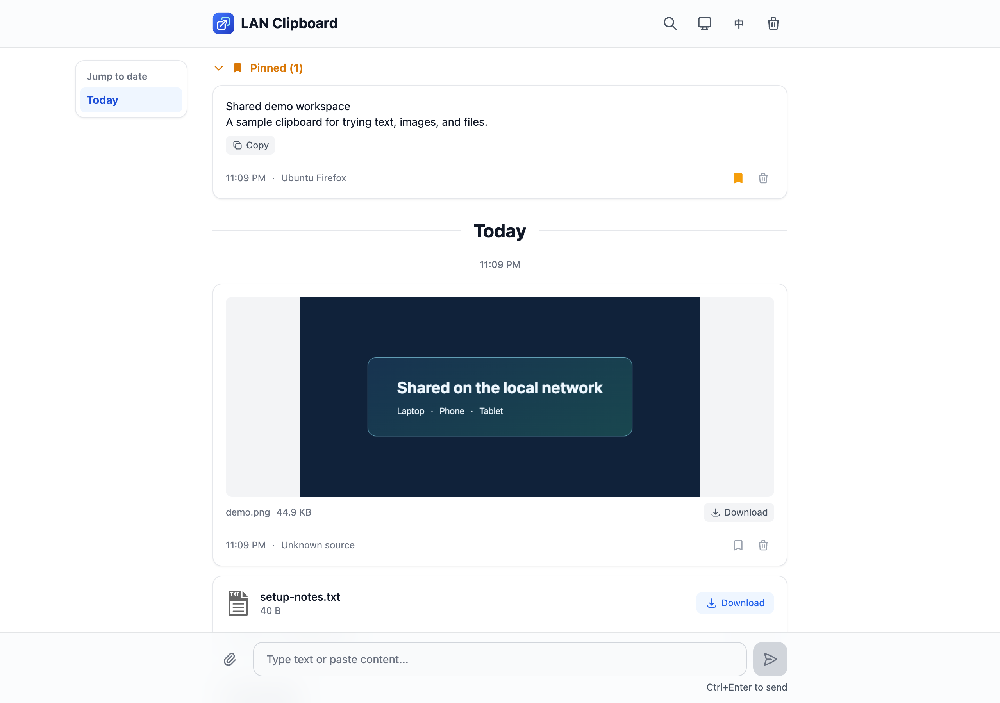
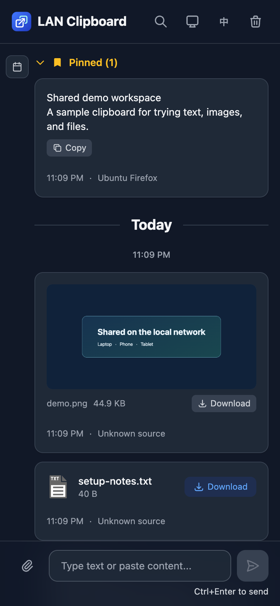

# LAN Clipboard · 局域网剪贴板

[English](../README.md) · **简体中文**

在一台电脑或 NAS 上部署，手机、平板和电脑就能通过浏览器实时共享文字、图片和文件。所有设备打开同一个地址，即可查看同一份剪贴历史。

## Docker 快速开始

部署 LAN Clipboard 的最佳方式是使用 Docker。

我们提供了方便的初始化脚本，请在运行 Docker 的 Linux、macOS 或 NAS 主机（通过 SSH）上操作。

1. 创建并进入一个新的部署目录，例如 `$HOME/docker/lan-clipboard`。

   ```sh
   mkdir -p "$HOME/docker/lan-clipboard" && cd "$HOME/docker/lan-clipboard"
   ```

2. 使用 curl 运行初始化脚本。

   ```sh
   curl -fsSL -o install.sh https://github.com/lan-clipboard-project/lan-clipboard/releases/latest/download/install.sh &&
     sh ./install.sh
   ```

   初始化脚本将自动识别终端语言（暂支持英文和简体中文），无法匹配时默认使用英文。

   初始化脚本会自动完成镜像拉取，并引导你进行个性化配置。

3. 用方向键选择，按回车确认。默认绑定宿主机的局域网 IPv4。选「自定义配置」（Customize settings）可以搜索并选择时区，也可修改端口、保留时间、文件大小和 Office 预览设置。

请在可信局域网使用（例如你的家庭局域网）。访问 LAN Clipboard 服务的设备可以读取、添加和删除共享内容。

如果你有更高级的安装需求（例如手动安装、自定义 NAS 数据目录、HTTPS、更新和备份等），也可以查看[部署指南](deployment.md)。

## 界面预览

| 桌面端 | 手机端 |
| --- | --- |
|  |  |

## 主要功能

- 直接粘贴文字和图片，拖拽或选择文件上传。
- 搜索剪贴历史，置顶常用内容。未置顶的内容默认保留 30 天。
- 在线预览图片、PDF、Markdown 和 Excel，支持中英文界面与深色模式。

## 项目链接

[更新日志](../CHANGELOG.md) · [开发与贡献](../CONTRIBUTING.md) · [安全策略](../SECURITY.md) · [MIT 许可证](../LICENSE) · [第三方许可](../THIRD_PARTY_NOTICES.md)
